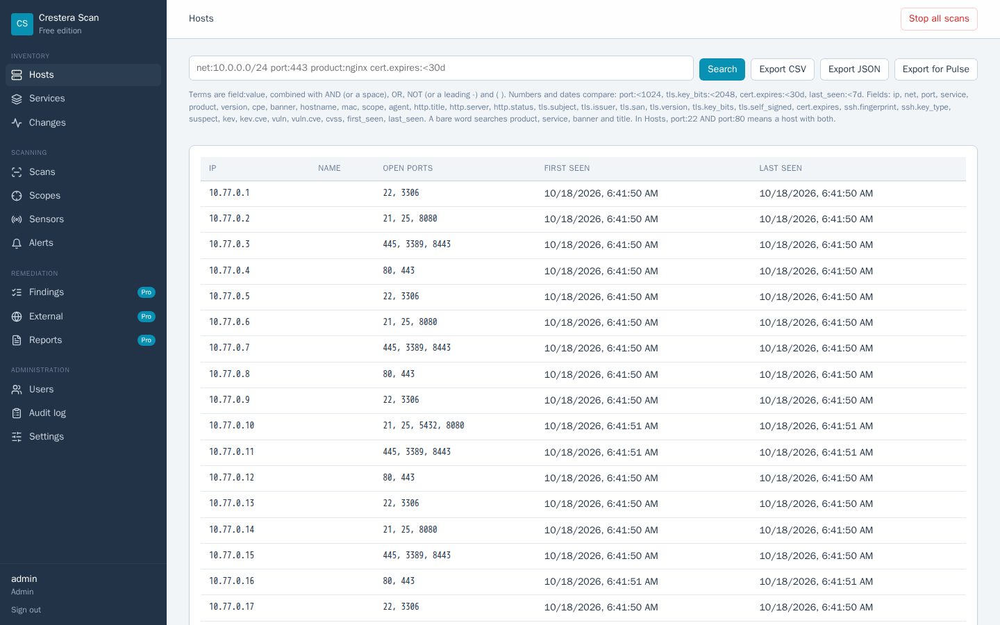

# Crestera Scan

Self-hosted network discovery for banks and credit unions. Point it at the
address ranges you are authorised to scan, and it records which hosts are
alive, what is listening on them, and what that software says about itself.
Shodan for your own network, on your own hardware.

The Free edition is free for your own organisation, commercial use included.
No host limits, no expiry, no sign-up.

Downloads: [Releases](https://github.com/bsalas77/crestera-scan/releases/latest).
Part of the Crestera family with [Crestera Watch](https://github.com/bsalas77/crestera-watch)
(SIEM) and [Crestera Pulse](https://github.com/bsalas77/crestera-pulse)
(executive dashboard); it needs neither.



---

## What the Free edition includes

| | |
|---|---|
| **Discovery** | TCP host discovery tuned for financial-institution networks, plus the operating system's ARP table on the local segment, and ports remembered from earlier scans. |
| **Port scans** | Top 100, top 1,000, all ports, or your own list. SYN scanning and ARP discovery on Linux. |
| **Identification** | Banners, HTTP titles and servers, TLS certificates (subject, issuer, expiry, key size), SSH host keys, matched against Rapid7 Recog fingerprints. |
| **Search** | `port:3389 net:10.20.0.0/24`, `cert.expires:<30d`, `kev:true`, with AND, OR, NOT and comparisons. Export to CSV and JSON. |
| **Scheduling and change** | Scheduled scans, a record of every change between runs (new hosts, opened ports, replaced certificates), and alerts by e-mail, syslog or signed webhook. |
| **Known-exploited software** | Services matched against the CISA Known Exploited Vulnerabilities catalog. |
| **Remote sensors** | Scan networks the server cannot reach. Sensors connect out only, with mutual TLS, and keep their own allowed ranges. |
| **Accounts** | Admin, operator and viewer roles, lockout, two-factor sign-in, and an append-only audit log. |
| **Integrations** | Hosts without a Crestera Watch agent; export to Crestera Pulse. |

**Pro** adds NVD version matching, findings with owners and deadlines,
FFIEC/NCUA/GLBA examiner reports, Entra ID single sign-on and external attack
surface discovery. It is the same program with a license key; the Pro
features show a badge in the Free edition.

## Install

**Linux** (Ubuntu, Debian, RHEL, AlmaLinux, Rocky; amd64 or arm64):

```bash
curl -LO https://github.com/bsalas77/crestera-scan/releases/latest/download/crestera-scan-linux-amd64
chmod +x crestera-scan-linux-amd64
sudo ./crestera-scan-linux-amd64 service install
```

The installer creates a system user, installs a hardened systemd service and
prints the console certificate's fingerprint and the first administrator
password. The console listens on `https://127.0.0.1:8443`;
[QUICKSTART.md](QUICKSTART.md) shows how to open it to other machines.

**Windows:** a code-signed Windows build will follow. Crestera Scan on Linux
scans Windows hosts like any other.

Check your download first: each release carries `SHA256SUMS` and an ed25519
signature that stock OpenSSL verifies. See
[Verifying a release](SECURITY.md#verifying-a-release).

Full walkthrough, from download to first scan: **[QUICKSTART.md](QUICKSTART.md)**.

## It only touches what you allow

A scanner aimed at the wrong network is the one failure this product cannot
have, so scope is enforced in the only code that can open a connection, not
applied as a filter to a target list:

- Every probe's destination address is checked immediately before it is
  sent: a built-in deny list first, then your exclusions, then your scopes.
- The deny list cannot be overridden: cloud metadata endpoints, multicast,
  broadcast, and the network and broadcast addresses of every scope.
- HTTP redirects are recorded, never followed.
- The default Safe profile sends nothing to a service: it connects, listens,
  and stays at 50 connections per second, two per host.

The test suite holds this in place, including a check that no other part of
the program can open a connection. Only scan networks you own or are
authorised in writing to test.

## Security

How Crestera Scan protects itself and your data, how to verify a release, and
how to report a vulnerability: [SECURITY.md](SECURITY.md).

## License

Free for your own organisation's internal use, including commercial use. It
may not be resold or hosted for others, and you may only scan networks you own
or are authorised to test. See [LICENSE](LICENSE) and
[THIRD-PARTY-NOTICES.md](THIRD-PARTY-NOTICES.md). For Pro, or questions about
licensing, write to the address at the end of LICENSE.
